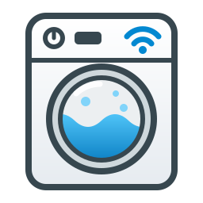
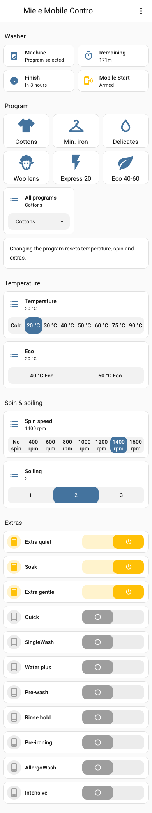

<div align="center">



# Miele Mobile Control

### Choose the program, temperature, spin speed and extras of your Miele washing machine from Home Assistant, the way the Miele app does.

The official Miele integration can only send a program number. This one sets everything the app can.

[](LICENSE)
[](https://github.com/hacs/integration)


**[What you get](#what-you-get) · [First wash](#three-steps-to-your-first-wash) · [Install](#quick-install) · [Dashboard](#a-dashboard-that-works-like-the-app) · [Automations](#let-home-assistant-run-the-wash) · [Good to know](#good-to-know)**

</div>

---

**Load, arm, walk away.** Arm Mobile Start at the machine when you load it. From then on Home Assistant does the rest: pick the program, the temperature, the spin speed and the extras, and start the wash when it suits you. By hand from the couch, or from an automation when electricity is cheap.

<p align="center">
  
</p>

## What You Get

- **Every program your machine has, by name.** Cottons, Minimum iron, Delicates, Woollens, Express 20 and the rest, read from the machine itself.
- **Temperature and spin speed**, eco temperatures included.
- **The extras as switches:** Extra quiet, Soak, Extra gentle, Quick, Pre-wash, Water plus, Pre-ironing, AllergoWash, Intensive and more.
- **Only valid choices.** Pick Minimum iron and the 75 °C and 90 °C options are gone, just like in the app.
- **Every change is read back** from the machine, so what you see is what it will wash.
- **Start from Home Assistant**, with a button or from an automation.
- **Status that always works:** what the machine is doing, time remaining, finish time, door, and whether it is armed.
- **Live readings while it runs:** target temperature, current spin speed, elapsed time, the raw program phase number, and a delayed start time.
- **A record of every wash:** program, temperature (with an eco flag), spin speed, soiling and every extra it ran with — separate sensors per detail, kept during the run and after it ends, surviving a Home Assistant restart. A wash started at the machine still records its program; details the integration never saw stay honestly unknown.
- **One binary sensor per wash extra** (Wash Soak, Wash Extra quiet, …): on when that extra was selected for the recorded wash, ready for charts and automations.
- **One action for presets and automations:** program, temperature, spin and extras in a single call.

It runs next to the official Miele integration and does not interfere with it. Keep that one for its sensors and history; add this one for control.

## Three Steps to Your First Wash

1. **Load and arm.** Put the laundry in, close the door, turn the dial to **MobileStart** and press **Start**. The display shows the machine is waiting for the app.
2. **Choose in Home Assistant.** Program first, then temperature, spin speed and extras.
3. **Start**, now or later. Press Start in Home Assistant, or let an automation do it.

The arming in step 1 is Miele's safety rule: a washer only listens to the outside world after someone at the machine said it may, and it has to be done for every wash. It is also what makes this useful. On the test machine an armed washer stayed ready for hours, so you can arm it in the morning and let Home Assistant start it in the afternoon.

Remote control has to be switched on once in the machine's settings.

## Quick Install

1. In HACS open the menu (three dots) and choose **Custom repositories**. Add `https://github.com/pcvelz/ha-miele-mobile-control` with type **Integration**.
2. Install **Miele Mobile Control** and restart Home Assistant.
3. Go to **Settings → Devices & services → Add integration** and pick **Miele Mobile Control**.
4. Sign in with the e-mail and password of your Miele account, the one the app uses.

**Will it work for me?**

- You have a Miele **washing machine** with Mobile Start that works in the Miele app. Dryers and washer-dryers are not supported yet.
- You sign in to the Miele app with **e-mail and password**, on Miele's European service.
- Home Assistant **2026.11** or newer.
- It has been tested on one model so far, a WSI863. Other Miele washers should behave the same; reports are welcome.

Your Miele e-mail and password are stored in Home Assistant, as with any account-based integration, and are sent only to Miele. More under [Privacy and safety](#good-to-know).

## A Dashboard That Works Like the App

[examples/dashboard.yaml](examples/dashboard.yaml) is the view in the screenshot, ready to paste. It uses stock Home Assistant cards only, so there is nothing else to install.

- The washer's status on top.
- One-tap buttons for the programs you use most, with the full list below.
- A row each for temperature, eco temperatures, spin speed and soiling.
- The extras as toggles, showing only those the selected program offers.
- When the machine is not armed, the controls make way for a card that tells you what to do at the machine.
- A Start tile that asks for confirmation first, and a preset button that loads a program without starting it.

Replace `wsi863` with your machine's model. The screenshot shows the view without the Start tile.

## Let Home Assistant Run the Wash

One action sets everything. This loads a preset and leaves the machine waiting:

```yaml
action: miele_mobile_control.set_program
target:
  entity_id: select.wsi863_program   # any entity of your washer
data:
  program: Cottons
  temperature: 20             # °C, 0 = cold
  spin_speed: 1400            # rpm, 0 = no spin
  extras:                     # these go on, the others off
    - extra_quiet
    - soak
```

Add `start: true` and it also starts. A wash you armed in the morning that runs in the afternoon:

```yaml
triggers:
  - trigger: time
    at: "13:00:00"
conditions:
  - condition: state
    entity_id: binary_sensor.wsi863_mobile_start
    state: "on"
actions:
  - action: miele_mobile_control.set_program
    target:
      entity_id: select.wsi863_program
    data:
      program: Cottons
      temperature: 40
      eco: true
      spin_speed: 1400
      start: true
```

> [!WARNING]
> A start cannot be undone from Home Assistant. The machine begins washing and the arming is used up. To stop a running program, use the machine.

<details>
<summary><b>More about the action</b></summary>

- **Program first, options after.** Choosing a program resets temperature, spin and extras to that program's defaults. The washer does this and the Miele app behaves the same. The action takes care of the order for you.
- **Extras:** use `extra_quiet`, `soak`, `gentle` (Extra gentle), `quick`, `single` (SingleWash), `water_plus`, `pre_wash`, `rinse_hold`, `steam_smoothing` (Pre-ironing), `allergo_wash`, `intensive`. The listed extras are switched on and the others the program lets you change are switched off, so a preset gives the same result every time.
- **A value the program does not offer is refused**, with a message that names the value and lists what is offered. If the washer is already on that program, nothing is written. If the call also switches to a different program, the options can only be checked once the washer shows that program: the program is then changed, the options are not applied, and the error says so.
- **Changes in quick succession** are applied one after another, so none is lost.
- `program` takes a name or a program number. `eco: true` picks the eco variant of the given temperature.

</details>

<details>
<summary><b>All entities</b></summary>

One device per washing machine on your Miele account, named after its model.

| Area | Entities |
|---|---|
| **Program** | `select.<machine>_program` |
| **Options** | `select.<machine>_temperature`, `_spin_speed`, `_soiling` |
| **Extras** | one `switch.<machine>_…` per extra. Unavailable when the selected program does not offer it; the `offered` attribute lets a dashboard hide it. |
| **Status** | `sensor.<machine>_status`, `_remaining_time`, `_finish_time`; `binary_sensor.<machine>_mobile_start`, `_door`. These work whether or not the machine is armed. |
| **Live (while running)** | `sensor.<machine>_target_temperature`, `_current_spin_speed`, `_elapsed_time`, `_program_phase` (raw number, diagnostic), `_start_time` (only with a delayed start). |
| **Wash record** | `sensor.<machine>_wash_state` (`none`/`running`/`finished`/`interrupted`), `_wash_program`, `_wash_temperature` (°C, `eco` attribute), `_wash_spin_speed`, `_wash_soiling`, `_wash_extras` (names plus one boolean attribute per offered extra), `_wash_started`, `_wash_finished`, `_wash_duration`; one `binary_sensor.<machine>_wash_…` per extra. The record is frozen when the program begins and kept until the next wash replaces it; it survives a restart. |
| **Start** | `button.<machine>_start` |

On a WSI863:

```
select.wsi863_program            select.wsi863_temperature
select.wsi863_spin_speed         select.wsi863_soiling
switch.wsi863_extra_quiet        switch.wsi863_soak
switch.wsi863_extra_gentle       switch.wsi863_quick
switch.wsi863_singlewash         switch.wsi863_water_plus
switch.wsi863_pre_wash           switch.wsi863_rinse_hold
switch.wsi863_pre_ironing        switch.wsi863_allergowash
switch.wsi863_intensive          switch.wsi863_extra_rinse
switch.wsi863_pre_rinse          switch.wsi863_microfibre
switch.wsi863_eco                switch.wsi863_starch_hold
switch.wsi863_hygiene_plus
sensor.wsi863_status             sensor.wsi863_remaining_time
sensor.wsi863_finish_time        sensor.wsi863_start_time
sensor.wsi863_target_temperature sensor.wsi863_current_spin_speed
sensor.wsi863_elapsed_time       sensor.wsi863_program_phase
sensor.wsi863_wash_state         sensor.wsi863_wash_program
sensor.wsi863_wash_temperature   sensor.wsi863_wash_spin_speed
sensor.wsi863_wash_soiling       sensor.wsi863_wash_extras
sensor.wsi863_wash_started       sensor.wsi863_wash_finished
sensor.wsi863_wash_duration
binary_sensor.wsi863_mobile_start
binary_sensor.wsi863_door
binary_sensor.wsi863_wash_quick         binary_sensor.wsi863_wash_singlewash
binary_sensor.wsi863_wash_water_plus    binary_sensor.wsi863_wash_extra_rinse
binary_sensor.wsi863_wash_pre_wash      binary_sensor.wsi863_wash_soak
binary_sensor.wsi863_wash_rinse_hold    binary_sensor.wsi863_wash_extra_quiet
binary_sensor.wsi863_wash_pre_ironing   binary_sensor.wsi863_wash_pre_rinse
binary_sensor.wsi863_wash_microfibre    binary_sensor.wsi863_wash_extra_gentle
binary_sensor.wsi863_wash_allergowash   binary_sensor.wsi863_wash_eco
binary_sensor.wsi863_wash_intensive     binary_sensor.wsi863_wash_starch_hold
binary_sensor.wsi863_wash_hygiene_plus
button.wsi863_start
```

</details>

## Good to Know

<details>
<summary><b>Compared to the official Miele integration</b></summary>

The official integration uses Miele's public 3rd Party API. For a washing machine that API accepts a program number and nothing else. The Miele app is not limited that way, because it uses a different, internal route. This integration uses that same route.

| | Official Miele integration | Miele Mobile Control |
|---|---|---|
| **Choose a program** | By program number only | By name, from the machine's own list |
| **Temperature** | No | Yes |
| **Spin speed** | No | Yes |
| **Extras** | No | Yes, one switch each |
| **Knows what a program offers** | No | Yes, only valid choices are shown |
| **Start** | Yes, when Mobile Start is armed | Yes, when Mobile Start is armed |
| **Appliances** | All Miele@home appliances | Washing machines |
| **Sign-in** | Miele account through OAuth | Miele account e-mail and password |
| **API** | Public, documented | Internal, undocumented |
| **Needs the Miele cloud** | Yes | Yes |

</details>

<details>
<summary><b>Limitations</b></summary>

- **Tested on one appliance:** WSI863, Wi-Fi module EK057, firmware 08.37.
- **Washing machines only.** Dryers and washer-dryers are not listed.
- **Start is new.** Starting from Home Assistant is implemented the way the app does it, but version 0.1.0 has not exercised it on a real machine yet. It is guarded: the machine's state is read fresh, a second start within 30 seconds is refused, a start is never retried automatically, and you get an error if the washer does not begin.
- **No real wash has been observed end to end.** Only off, on and program selected were seen on the test machine. Everything from "waiting to start" onwards — the wash record, its finish and duration, the live readings of a running program — is covered by tests against captured data, not by a real run. Report what your machine shows.
- **The wash record is honest about what it never saw.** It freezes the last program context read while Mobile Start was armed with a program selected. A wash started at the machine without the integration seeing a context records only the program (`/State` `ProgramID`); temperature, spin, soiling and extras stay unknown, never invented. Whether the program context can still be read while the washer waits to start or runs is untested, so the record deliberately does not depend on it.
- **"Started" means armed and counting down.** `wash_started` is the moment the machine entered waiting-to-start or running, so it includes a delayed start. If waiting is cancelled at the machine, the record closes as interrupted.
- **Some status values are untested.** Off, on, program selected, waiting and running were seen on the test machine. Paused, finished and failure follow Miele's public documentation; the wash record treats only Status 7 as "finished" and everything else that ends a run as "interrupted".
- **European Miele service only, e-mail and password sign-in only.** Miele is moving countries to a newer sign-in (France was the first); accounts there cannot log in.
- **Not there yet:** TwinDos dosing, stains, capsule dosing, delayed start.
- **Soiling shows as 1, 2, 3.** The names of the levels are not confirmed.
- **No changes while the machine waits to start or runs.**
- **Cloud only.** It needs internet and Miele's cloud. On the tested Wi-Fi module the local network offers no program control at all.
- **The washer says nothing about its programs while it is off.**

</details>

<details>
<summary><b>Privacy and safety</b></summary>

- **Stored:** your Miele e-mail, password and country, in Home Assistant's own config storage, where every account-based integration keeps its sign-in. The session token lives in memory only.
- **Sent:** only to Miele's cloud (`rest-eu.domestic.miele-iot.com`): sign-in, reading the machine, writing the selection. This is what the app sends.
- **No telemetry.** Nothing is reported to the author or anyone else.
- **Never starts by itself.** A start happens only when you press the button or call the action with `start: true`.
- **Undocumented API.** Miele can change or block it at any time. Use at your own risk.
- Not affiliated with or endorsed by Miele. See [SECURITY.md](SECURITY.md) to report a problem.

</details>

<details>
<summary><b>Troubleshooting</b></summary>

- **All controls are unavailable.** The washer is off or not armed. Arm it at the machine; the controls appear within 30 seconds. The status sensors keep working either way.
- **Setup refuses the account.** Check e-mail, password and country. Accounts in a country that Miele has moved to its newer sign-in cannot log in yet.
- **Temperature, spin or extras jumped back.** Choosing a program resets them to that program's defaults. Set the program first, then the options.
- **A change took a few seconds to show.** Each change is sent to the machine and read back; that takes up to about 8 seconds.
- **Something else.** Turn on debug logging, reproduce it, and open an [issue](https://github.com/pcvelz/ha-miele-mobile-control/issues) with the log:

  ```yaml
  logger:
    logs:
      custom_components.miele_mobile_control: debug
  ```

</details>

<details>
<summary><b>Uninstall</b></summary>

Delete the integration under **Settings → Devices & services**, remove it in HACS and restart Home Assistant. That removes the entities and the stored sign-in.

</details>

<details>
<summary><b>How it works</b></summary>

The Miele app talks to a washer through Miele's cloud, by reading and writing a handful of the machine's own data objects. How the app does that for laundry was worked out by [jplot/koti](https://github.com/jplot/koti); the object layouts and the write sequence used here come from that project.

1. **Sign in** like the app: e-mail and password give a session token, renewed before it expires.
2. **Read the state** of the machine every 30 seconds.
3. While the machine is armed, read the **program list** and the **program context**: every option of the selected program, its allowed values and its current value.
4. To change something, read the **program selection** object, change the fields, and write it back. A new program is written first; its options follow once the machine shows that program.
5. Wait for the machine to show the new values before the next change goes out.

The objects use Miele's binary DOP2 format. [akappner/MieleRESTServer](https://github.com/akappner/MieleRESTServer) works with the same format on the local network and helped confirm the layout against a real machine. The program names come from [tiehfood/ha-miele-at-lan](https://github.com/tiehfood/ha-miele-at-lan), a Home Assistant integration for Miele's local protocol.

</details>

<details>
<summary><b>Development</b></summary>

```bash
python3 -m pip install pytest aiohttp
python3 -m pytest
```

The tests need Python 3.13 or newer, not Home Assistant. `dop2.py` reads and writes the binary format and `washer.py` holds the washer logic; both are plain Python. `tests/fixtures/wsi863.json` holds objects captured from a real machine, including a write the machine accepted, which the encoder must reproduce byte for byte.

</details>

## Licence

[MIT](LICENSE)
